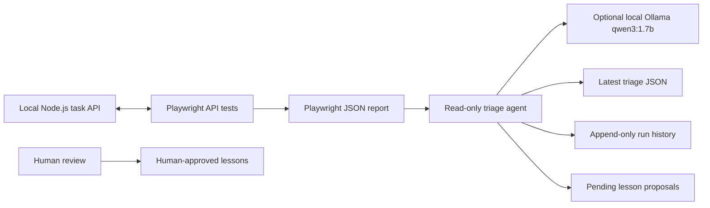

# API Quality Lab

API Quality Lab is a free, local QA portfolio project. It pairs a small Node.js task API with Playwright API tests and an optional AI-assisted triage step powered by a local Ollama model.

The project uses synthetic task data only. The API binds to the loopback interface by default; `HOST` can be overridden for the optional deployment lesson. The triage tool does not call a hosted AI service.

## Requirements

- Node.js 20 or newer and npm.
- Ollama is optional. For local AI analysis, install and run Ollama with `qwen3:1.7b` available.
- No browser download is needed because the tests use Playwright's API request context, not browser automation.

If `qwen3:1.7b` is not already present in Ollama, download it once for local use:

```powershell
ollama pull qwen3:1.7b
ollama list
```

## Installation

From the project folder in Windows PowerShell:

```powershell
npm.cmd ci
```

`npm ci` installs the exact project dependencies recorded in `package-lock.json`.

## Commands

Start the local API:

```powershell
npm.cmd start
```

The API listens at `http://127.0.0.1:3000` by default. Set `PORT` to use a different local port:

```powershell
$env:PORT = '3001'
npm.cmd start
```

Run the Playwright API contract suite:

```powershell
npm.cmd test
```

The suite starts a fresh API server for each test on an available loopback port, so it does not depend on the manually started server. Playwright writes the latest JSON report to `artifacts/test-results/playwright-report.json`.

Analyze the latest Playwright report:

```powershell
npm.cmd run triage
```

Analyze a previously saved report:

```powershell
npm.cmd run triage -- --report artifacts/run-history/2026-10-31-whitespace-title-defect.json
```

Optional local Ollama settings:

```powershell
$env:OLLAMA_MODEL = 'qwen3:1.7b'
$env:OLLAMA_GENERATION_TIMEOUT_MS = '300000'
```

`OLLAMA_BASE_URL` defaults to `http://127.0.0.1:11434`. The triage agent only accepts HTTP on `localhost` or a loopback address. If the service or model is unavailable, triage records the limitation and uses a conservative fallback classification.

## Architecture



### API and tests

- `src/api.js` creates an HTTP server with a new in-memory task store for every server instance.
- `src/server.js` starts the standalone API on loopback by default. Set `HOST` to change the bind address for deployment.
- `tests/fixtures/api.fixture.js` starts and closes an isolated API server for every test on an ephemeral port.
- `tests/api/tasks.spec.js` verifies response envelopes, headers, valid and invalid titles, task completion and deletion, and missing IDs.
- `playwright.config.js` enables parallel execution and writes both a readable console report and a JSON report.

### Triage and human review

1. Playwright writes its structured JSON report.
2. `src/triage.js` extracts failed tests, assertion evidence, expected and received values, and relative source locations. It removes local project paths before saving or sending evidence to the model.
3. When failures exist, the agent checks the local Ollama model list and sends the failure evidence plus the API contract from `docs/test-plan.md` to `qwen3:1.7b`.
4. The model may return one of four labels: `application_bug`, `test_issue`, `environment_issue`, or `unknown`. The agent keeps evidence from the Playwright report separate from the model's classification and suggested next step.
5. The agent writes `artifacts/triage/latest.json`, appends one record per triage invocation to `artifacts/run-history.jsonl`, and saves any lesson suggestion to `lessons/proposed.jsonl` with `pending_human_review` status.
6. A person reviews each proposal against the test plan and evidence. Only a person may add an approved lesson to `lessons/approved.md`.

Run triage after each Playwright execution to add that report to the run history before a later test run replaces the latest report. Archived reports in `artifacts/run-history/` preserve selected runs as evidence.

## Project documents

- [Test plan](docs/test-plan.md)
- [Controlled bug report](docs/bug-reports/BUG-001-whitespace-only-task-title.md)
- [Lesson review rules](lessons/README.md)
- [CI/CD from zero: the beginner's guide](lessons/ci-cd-from-zero.md)

## CI/CD learning project

The GitHub Actions workflow in `.github/workflows/ci.yml` runs `npm ci` and the Playwright API tests for pull requests into `main` and pushes to `main`. It saves the JSON test report as a downloadable workflow artifact. If you configure the optional Render settings described in the guide, a successful push to `main` also triggers a deployment.

The API stays bound to `127.0.0.1` on your computer by default. For a Render web service, set `HOST` to `0.0.0.0`; the guide explains why and walks through the setup.

## Limitations

- Task data is in memory and is lost when its server instance stops.
- The API is a learning example; it has no authentication, persistence, or production hardening. The optional Render deployment is for synthetic demo data only.
- Ollama analysis is optional and advisory. The small local model can misclassify failures or propose poor lessons. Check every classification and proposal against the test report and test plan.
- The triage agent cannot execute model suggestions, modify application or test source files, or write to `lessons/approved.md`.
- The run history records a triage invocation, not every `npm.cmd test` command automatically. Run triage after a test run to preserve its summary and analysis.
